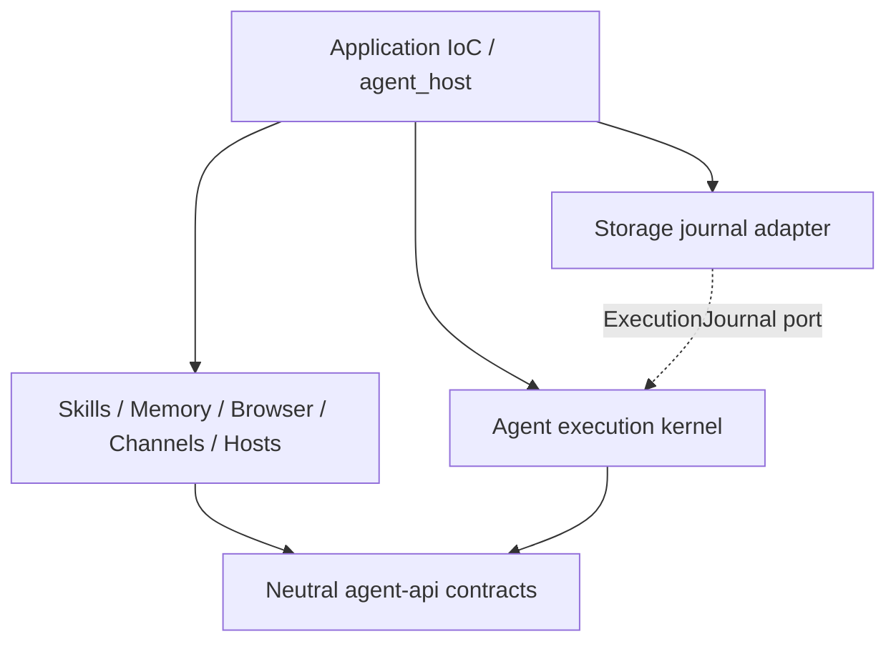

# Agent layering and progressive capability discovery

2026-10-29. This document distinguishes intended boundaries, current implementation
and remaining work. Capabilities internal to an external ACP executor are not
counted as Ovule's own implementation.

## Design decision

The agent service is an execution kernel. Its center is the LLM loop, together with
turn/step lifecycle, call/result pairing, budgets, cancellation, events and execution
admission. These invariants must have one owner rather than being scattered across
tools and upper-level workflows. Application and host adapters live outside the kernel.

Domain services own business capabilities. The agent consumes contracts and
Attempt-scoped providers. A service here means a replaceable Rust component with
explicit resource ownership; it does not require a separate process, crate or MCP
server for every responsibility. Existing IoC composition, Rig, rmcp, Skills parsing,
Memory repositories and Workflow infrastructure remain reusable.

The model discovers **the capability catalog authorized for this Attempt**, rather
than an unrestricted global IoC registry. Discovery, loading, startup, authorization
and invocation are distinct actions.

## Five responsibilities and shared invariants

| Responsibility | Contents | Owner and boundary |
| --- | --- | --- |
| Execution kernel | Model requests and streaming, ReAct action/observation loop, termination, call/result correlation, budgets and cancellation | `services/agent/src/runtime.rs` and kernel modules; model integration uses adapters, while external ACP adapters belong to the application |
| Capabilities | Files, processes, Browser, Computer, connectors, Think/Plan tools and Skills | Domain services own implementations, resources and health; the agent consumes Attempt-scoped providers |
| Context | Instructions, history projection, budgets, compaction, Memory, RAG and Contextual Retrieval | The kernel owns request projection and budget contracts; Skills, Memory and retrieval services own content and indexes |
| Long tasks and orchestration | Goals, Workflow, task trees, subagents, scheduling, checkpoints and recovery | Workflow, Conversation and persistence services invoke bounded agent Attempts and retain durable task ownership |
| Production governance | Policy, approval, sandboxing, audit, monitoring, evaluation and quotas | Policy, storage and evaluation implementations are replaceable; execution admission must enforce them |

Security, cancellation, correlation IDs, observable events and durable commit
boundaries are shared invariants. Skill instructions cannot replace enforcement,
and governance cannot wait until the model discovers a safety service. Long-term
Memory, tool execution journals, Workflow checkpoints and model rollouts serve
different purposes; none substitutes for the others' recovery guarantees.

ReAct is a loop execution strategy. Planning generates and revises plans. Workflow
provides explicit state graphs and scheduling. A Workflow node can run a ReAct agent,
and an agent can request plan changes, while orchestration constrains persistence
and task dependencies.

A Think tool can be an optional scratchpad without external side effects. Private
model reasoning is not recoverable state. Skills provide guidance and resource
references; they neither implement executable tools nor grant permissions. RAG is
a retrieval augmentation pattern, and Contextual Retrieval is a replaceable indexing
and retrieval technique.

## References and tradeoffs

- [pi-agent core](https://github.com/earendil-works/pi/tree/main/packages/agent), its
  [loop](https://github.com/earendil-works/pi/blob/main/packages/agent/src/agent-loop.ts)
  and [types](https://github.com/earendil-works/pi/blob/main/packages/agent/src/types.ts)
  compose applications through streaming, context conversion, request preparation
  and tool lifecycle contracts. Ovule adopts these composition seams without adding
  another TypeScript runtime. The reference was the visible main branch on
  2026-10-29, not a pinned version or performance baseline.
- [Codex CLI registry, pinned at 970111f6](https://github.com/openai/codex/blob/970111f6cb62cc02fe36a82ea7d71b37a2889c97/codex-rs/core/src/tools/registry.rs)
  illustrates why a tool runtime also needs cancellation, environment, hooks,
  metadata and telemetry contracts.
- [OpenAI's architecture overview](https://developers.openai.com/blog/codex-as-a-platform)
  places business context and tools in the product, with runtime and execution
  boundaries in the harness. The specific service boundaries below are Ovule's
  design decisions.

The chosen combination is a small model loop, explicit host contracts and domain
capability services. Upstream directory placement does not dictate Ovule's service
ownership, and a small loop still requires production execution contracts.

## Implemented behavior

```mermaid
flowchart LR
    A[Selected Attempt capabilities and scope] --> B[Provider assembly and protocol adaptation]
    B --> C[CapabilityCatalog]
    C --> D[Initially expose only ovule_capabilities]
    D --> E[Search metadata / load exact names]
    E --> F[Expose loaded schemas on the next request]
    F --> G[Validate names exposed by the originating request]
    G --> H[ToolExecutor admission / approval / cancellation / journal]
    H --> I[Domain implementation or selected MCP]
    I --> J[Observation and call correlation]
    J --> F
```

- `crates/ovule-agent-api` owns neutral `CapabilityDefinition`, `CapabilityProvider`,
  `CapabilityLease`, effect policy and event contracts. It has no dependency on
  domain services, the agent kernel, storage, Framework or IoC.
- `services/agent` owns the LLM/Rig loop, stream projection, `CapabilityCatalog`,
  `CapabilityRegistry`, ToolExecutor, approval, cancellation, deadlines and an
  execution journal port. Its only Ovule production dependency is `ovule-agent-api`.
  ACP, MCP, domain services and SQLite implementations remain outside the kernel.
- Skills, Memory, Browser and Channels own their providers in `capability.rs`.
  Hosts owns Workspace/Computer transport and MCP providers in `capability.rs`,
  `capability/computer.rs` and `mcp.rs`. Domains depend on the neutral API rather
  than the kernel.
- `src/agent_host.rs` and its children own application scheduling, Attempt preparation
  and ACP, authorization and MCP server adapters. `capabilities.rs` composes domain
  providers; `providers.rs` registers IoC factories. IoC injects shared `AgentKernel`
  and `ProviderAssembly` instances. `ModelTurn` receives the assembled provider list;
  neither the registry nor the model loop resolves services from a container.
- `ExecutionJournal` is a kernel consumer port. The application adapter uses the
  existing storage repository and preserves durable intent before dispatch and
  settlement after dispatch.
- Rig initially exposes only `ovule_capabilities`. `search` returns names,
  descriptions of up to 240 characters, load state and matching provider summaries,
  without schemas. `providers` paginates independently. Explicit `acquire` starts
  or connects MCP, reads credentials and enumerates tools only after service selection.
  `load` atomically loads schemas for the next model request.
- Search returns eight items per page. One load accepts 1–8 tools. At most 32 tools
  can be loaded, within a 48,000-byte serialized schema budget. This is not a token
  budget. The catalog holds at most 2048 items; combined discovery responses have a
  separate 12,000-byte limit and require a narrower query on overflow instead of
  truncating JSON.
- Reserved name collisions, duplicate definitions, invalid requests, tools outside
  the catalog and excessive loads fail explicitly. Failed loads leave the loaded
  set unchanged. Ordering is stable for the same loaded set.
- Dispatch validates against tools exposed by the request that produced the call.
  Loading and invoking a newly loaded tool in the same batch is rejected, preventing
  invocation based on an unseen schema. Discovery and loading also pass through
  ToolExecutor cancellation, event and journal handling.
- Loading does not change grants. Domain calls retain permission, approval, scope,
  deadline and journal enforcement. Planning remains a structured completion without
  tools or MCP initialization. Final answers and empty-answer recovery disable tools.
- Workspace tools are hidden when Workspace is unselected. Browser factories are
  available only with a local Host and consume a lease on first acquisition.
  Computer factories follow selected tools and transport.

Validation covers catalog pagination, Unicode queries, atomic loads, Attempt
isolation, stable ordering, unknown fields and budget rejection. Real local HTTP/SSE
fixtures exercise initial discovery, next-request loading, same-batch rejection and
subsequent invocation. These establish mechanical contracts, not improved model task
success rates.

## Progressive discovery lifecycle

1. **Discover:** The host provides service summaries based on profile, scope, Host
   and health. Disabled capabilities' credentials, addresses and global registration
   details stay outside model context.
2. **Describe / Load:** Select services or tools and load schemas or Skill bodies
   within budget. Return revisions and freeze definitions for an Attempt; changes
   take effect in a new Attempt rather than silently switching execution targets.
3. **Acquire:** The host owns lazy startup, authentication, connections, health,
   capacity and leases. Failure affects the selected service. Acquisition does not
   approve external effects, and credentials never travel through model arguments.
4. **Invoke:** Bind requests to Attempt, call ID, scope, deadline, cancellation and
   effect policy. ToolExecutor enforces admission.
5. **Release:** Revoke Attempt permissions, close connections and leases, cancel and
   await tasks. Persistent jobs require explicit owners.

Progressive disclosure reduces initial schema size when many tools exist, at the
cost of discovery turns and possible retrieval misses. Profiles could bootstrap a
small set of frequent, inexpensive tools after task evaluation. The current design
uses one discovery entry point without assuming that hiding more tools is always
better.

## Current boundaries and remaining work

Rig uses injected providers, lazy MCP acquisition, isolated connection failures and
lease cleanup. External ACP agents retain ownership of their own tools. Local
Attempt MCP keeps its existing protocol, and remote ACP Host context restrictions
remain. Application adapters own host and ACP integration. Tool execution journals
do not provide complete model recovery.

`CapabilityProvider::descriptor` and `definitions` provide metadata. `acquire`
returns an Attempt-owned `CapabilityLease` with fixed definitions, invocation and
idempotent close. Static native tools acquire automatically on invocation; MCP uses
explicit provider acquisition. Browser factories retain only the broker until first
acquisition, and closing the Attempt lease releases capacity. Borrowed global
Memory, Workspace, Channel and Computer ports survive Attempt cleanup. Trusted
providers classify effects, defaulting to External. The kernel does not exempt
`ovule_*` names from approval, and MCP annotations cannot lower privileges.

Provider states are `dormant → ready / failed → closed`. Acquisition or connection
failure locks only that provider, without automatic reconnection or replay. Ordinary
tool errors and MCP protocol rejections preserve the connection; transport and
cancellation failures invalidate it. New tools register atomically. Invalid definitions
or duplicate ownership reject only the new provider. Definition changes require a
new Attempt.

Acquisition has a default total budget of 20 seconds, including process startup,
initialization and bounded `tools/list` pagination. A service may expose at most
2048 tools, with each definition limited to 128,000 bytes. Duplicate cursors and names
are rejected. An Attempt supports at most 128 providers. Connection pooling,
background health checks, automatic authentication repair and live provider refresh
are not implemented.

Rig shuts down the registry after success, model failure, cancellation and Attempt
timeout. Acquired leases close concurrently, with a default four-second budget per
close. Failures and timeouts produce `close_failed` and `close_timeout`; repeated
shutdown preserves earlier cleanup failures. Rig marks such Attempts as failed.
HTTP uses rmcp to close transport and request remote session termination. Stdio uses
processkit ProcessGroup for the process tree and explicitly kills and reaps the
direct child.

The HTTP fixture covers servers that support DELETE. rmcp only logs rejected remote
DELETE requests, so local `closed` state does not confirm third-party resource
deletion. Servers without DELETE support or an initialization session ID rely on
server session expiry. RAII guards close connections and terminate process groups
when initialization or enumeration is dropped; cleanup does not reuse a cancelled
token. Detached processes outside platform containment and host SIGKILL/abort are
outside the verified guarantees. Windows and Linux reuse processkit; this round's
runtime validation used macOS.

`harness/provider` records provider identity and state. `harness/tool_projection`
records call identity, state and duration without copying credentials or tool bodies.
Discovery catalogs omit endpoints, argv, environment variables and credentials. Rig
assembly no longer generates external ACP MCP configuration, avoiding premature
credential reads that could fail the entire Attempt. Required Toolchain installation
checks remain profile preparation requirements, distinct from connection isolation.

Coverage includes injected provider isolation, error classification, cancellation,
budgets and duplicate ownership; real stdio process and descendant cleanup after
close, Drop, initialization/enumeration/invocation cancellation and enumeration
timeout; lazy HTTP connection and session deletion; Browser capacity release; and
MCP lease cleanup after model success or failure. Stdio fixtures require python3.
These are contract and resource tests rather than model effectiveness benchmarks.

Next priorities are durable model rollout and recovery commit contracts, followed
by unified request budgets and compaction. Use the existing
[capability gap review](agent-capability-gap-review.md) to guide crash injection and
side-effect replay prevention. Journals cannot reconstruct complete model history,
and timeout does not imply rollback. Multi-agent projection should reuse Workflow's
durable task tree. Retrieval and automatic Memory consolidation remain optional
services that require governance contracts before deployment.

Acceptance should cover success rates with identical models, tasks and budgets;
extra discovery turns; schema bytes and tokens; incorrect selection; cancellation
cleanup; isolated connection failures; rejection of stale revisions; complete
call/result pairing during recovery; and prevention of repeated external effects.

## Dependency direction and Rust module layout

The API crate is the shared implementation boundary and owns neither service
registration nor tool implementations. Domain services cannot import `ovule-agent`
in production. Hosts uses it only in dev-dependencies to test the real registry.
`WorkerEvent` and `WorkerOutcome` each have one definition in the API. Conversation
consumes and reexports those contracts without introducing a domain-to-kernel edge.

New or migrated Rust modules use `foo.rs` with `foo/child.rs`, without `foo/mod.rs`.
The agent kernel and application `agent_host` trees follow this layout. Architecture
tests verify production dependencies, domain use of the neutral API and the absence
of `mod.rs` in both trees; relocating files cannot excuse reverse dependencies.

Application assembly and context evaluation live in the root crate's
`tests/harness_assembly.rs` and `examples/harness_evaluate.rs`. Hosts owns MCP
fixtures; kernel tests inject fake providers and journals. Run deterministic contract
evaluation with `cargo run -p ovule --no-default-features --example harness_evaluate`.

## Prompt assets

Kernel prompts live in `services/agent/prompts/`; application context and output
protocol prompts live in `src/agent_host/prompts/`. Each directory's README documents
call sites and editing rules. Markdown bodies use `include_str!`, with Rust
`format!` / `write!` checking dynamic placeholders at compile time. There is no
runtime file loading, recursive interpolation or hot override mechanism. Typed code
continues to enforce schemas, permissions, budgets and cancellation. Prompt edits
are versioned with implementation changes; contract verification and model
effectiveness evaluation remain separate.

## User-visible tool details

Value-returning provider calls project bounded input, output and error previews into
expandable conversation cards. Execution diagnostics and journal entries remain
body-free. See [tool observability](agent-tool-observability.md) for persistence,
redaction limits, historical evidence and desktop input boundaries.

## Scoped execution permissions

Hosts now owns configurable read, write, network and process-inspection permissions.
Application IoC injects the trusted baseline; models query `ovule_workspace_policy`
and may request additional permissions for a single approved invocation. The neutral
`ExternalOnce` effect prevents task-wide approval reuse. See
[execution permissions](agent-execution-permissions.md) for configuration, examples,
platform limits and result classification.

Provider admission can implement `CapabilityProvider::preflight` for bounded
metadata-only validation before authorization. The kernel observes validation
failures without dispatch or approval. Domain services retain validation rules;
the contract does not move filesystem, command or credential policy into the
Agent loop. Providers must still validate again when enforcing an invocation.

## Runtime vocabulary

Keep model endpoint metadata separate from domain capabilities:

- `runtime/model_metadata.rs` owns optional `/models` discovery, its bounded
  credential-isolated cache and output-budget policy. `ModelMetadata` describes
  advertised token limits, context window and effort metadata; it grants no tools.
- `runtime/tool_projection.rs` owns `AttemptTools`, the Rig-specific projection
  of injected tool definitions and results. It delegates lifecycle and invocation.
- `CapabilityProvider`, `CapabilityLease` and `CapabilityRegistry` describe the
  domain services available to an Attempt, including disclosure and cleanup.

Model-round diagnostics use `model_metadata` and `model_metadata_source`.
`model_capabilities` and `capability_source` remain compatibility aliases at the
serialization boundary for existing diagnostic consumers. New code should use
only the metadata names; the legacy aliases do not describe Attempt permissions.

History actions return `MessageActionResult` (Thread ID plus snapshot). Explicit
fork creates a Thread; prompt restart keeps its Thread. The native message service
revokes active Workers from authoritative state before replacing history, so
correctness does not depend on a renderer's cached Attempt list. The application
facade inherits command methods from the conversation ingress port instead of
declaring duplicate spawn/cancel methods.
