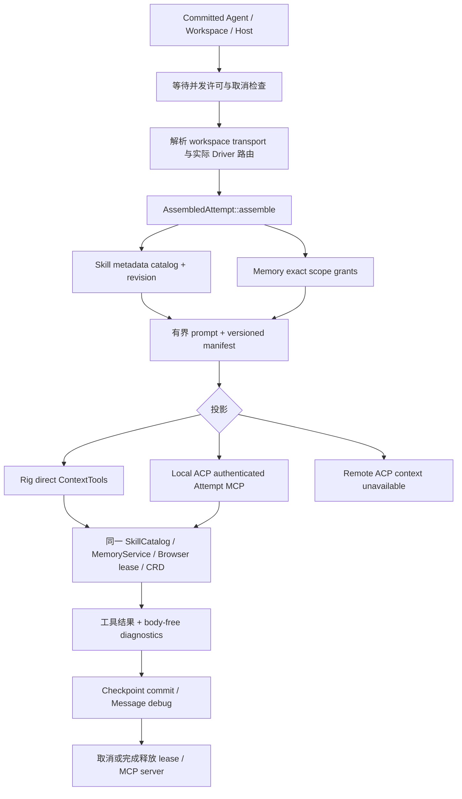
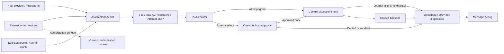

# Ovule agent harness 与能力架构

本文件定义当前可执行装配与扩展合同。开源依据与 crate 复用决策见 [调研记录](harness-research.md)。能力目录是 discovery / diagnostics 投影，
不是授权器；`ready` 仅表示宿主声明可用。实际调用还受 Attempt 的 workspace、
Agent 配置、凭证、后端健康与授权策略限制。UI 中存在某个面板，也不代表模型能调用它。

## 1. 概念与依赖方向

```text
Workflow / Goal / Task / Gate                 orchestration
                  ↓ dispatch / cancel
Attempt harness                              execution lifecycle
  context → driver → tool call → result → events → checkpoint
                ↓                 ↓
      Ovule (Rig) / ACP       capability adapters
                             ↓ policy / resource ownership
                         domain services
                             ↓
                 local / SSH / Ovule Link / Tuffite
```

- **Agent** 是选定 driver、model、instructions、skills 和 tools 的持久化配置。
- **Driver** 适配模型或外部 ACP 协议，不拥有另一套任务树、存储或扩展加载器。
- **Harness** 是一次 Attempt 的执行环境：装配上下文、选择入口、控制生命周期、
  处理取消与错误、归一化输出。它不是所有产品功能的总称，也不等同于 Rig。
- **Capability** 是有稳定语义的能力域，例如 browser、computer、workspace。
- **Operation** 是能力内的具体动作；**projection** 是动作实际可达的协议入口。
- **Provider/backend** 实现动作；**resource** 是带作用域与生命周期的 tab、PTY、
  workspace 或 desktop session。它们不应被一条无类型的 tool URL 取代。
- **Tool** 是模型可调用入口。一个 capability 可以有多个 tools；纯宿主服务也可以没有 tool。
- **Extension** 是代码或声明的分发单元；它不是宿主能力必须拥有的容器。

服务依赖通过现有 IoC 注册，面向消费方定义的 port。Registry 只引用发现数据，
不反向依赖 UI，不路由像素/PTY 流，也不承担执行。新增能力不应给 Rig、ACP、
ShellAPI 分别复制一套实现。

## 2. 分层与当前支持矩阵

| 能力域 | 所属层 / 生命周期 | 当前入口 | 模型可达性与边界 |
| --- | --- | --- | --- |
| Browser Use | 原生交互 / Attempt 隔离 Explorer | Rig direct、本地 ACP 的 Attempt MCP、ShellAPI response bridge | HTTP(S)、snapshot/ref、合成 DOM input、typed PNG；用户接管阻断输入，旧 ref 失效 |
| Computer Use | 原生交互 / physical desktop、session | Rig direct、认证 loopback HTTP MCP、ShellAPI | 复用 CRD capture/input；Local 与 Link 按 transport 分派，SSH 不假装具备本地桌面 |
| Workspace I/O 与命令 | 执行 / selected workspace、Attempt | Rig tools、ACP client、ShellAPI | 路径、远端执行与文件访问受选定 workspace 约束 |
| Terminal | 交互会话 / PTY run | ShellAPI、原生流 | 可观察终端不是持久 PTY 模型工具；不能把 exec 与 PTY write 混为一谈 |
| Toolchains | 执行依赖 / Host | Host service、setup UI | 解析、安装、探测可执行程序；安装不授予 Agent 执行权限 |
| Workflow | 编排 / Goal、Task、Attempt、Gate | Workflow service、ShellAPI | 拥有调度、重试、交接与取消，位于 harness 之上 |
| Storage | 持久化 / application checkpoint | 内部 repository port | SQLite checkpoint 与 event 同事务提交；不暴露 SQL 给 Agent |
| Skills | 指令上下文 / profile、Attempt | metadata → `ovule_skills.read` → resource | revision 固定、有界分页、资源根校验；不授予权限 |
| Human handoff | 控制交接 / Thread、Attempt | host block、prompt、UI | 卡片用于请求交接；卡片本身不是恢复授权 |
| Memory | 长期知识 / Thread、只读 Project | `ovule_memory` Rig direct / 本地 Attempt MCP | SQLite FTS5 关键词检索、有来源文档、CAS revision、TTL、删除；没有 embedding 语义检索 |
| Extension / MCP | 分发 / package、Agent session | contribution contract / MCP | 外部工具受相同调用与凭证边界约束，不提升为宿主权限 |

Registry 位于 `services/workspace/src/state/capabilities.rs`，宿主静态定义单独放在
`capabilities/builtins.rs`；`CapabilityKind` / `CapabilityBackend` /
`CapabilityProjection` 使用类型化枚举约束内部分类。`backend` 描述实现，
`kind` 描述职责，`source` 描述所有权，`projections` 描述已实现入口；
`agent_exposures` 只描述所选配置的路由，不能替代运行时授权或连接探测。
没有 `agent_exposures` 的宿主项不应被自动加入模型 tool list。

## 3. Harness 装配与扩展合同

一次 Attempt 的装配由 `services/agent/src/harness` 实现，`services/agent/src/runtime/mod.rs`
负责将其接入执行生命周期：

Harness 是 Agent 内部执行机制，不再独立成 service crate；原 `ovule-harness` 只有 Agent
消费，现合并为 `ovule_agent::harness`。Memory、Skills、Browser 仍是独立能力域。
诊断协议名 `ovule-harness/2` 与 crate 名解耦并保持不变，已有记录和评估 case ID 无需迁移。

```text
services/agent/src/
  lib.rs / providers.rs             公共消费方合同 / IoC 装配
  harness/
    assembly.rs                     prompt、scope grants、manifest
    context.rs                      共用 Skills / Memory 工具语义
    telemetry.rs                    body-free trace 合同
  runtime/
    mod.rs                          Attempt 调度、准备、资源生命周期
    drivers/{acp,rig,codex_login}.rs 协议、模型循环与外部 driver 登录
    mcp/{computer,context}.rs        宿主 Computer / Attempt context 投影
    thought_stream.rs / support.rs  输出解析及运行时辅助
    tests.rs                        调度与 driver 集成测试
```

`drivers` 和 `mcp` 保持 runtime 私有，仅在其内部共享可见性；不把协议实现暴露为另一个
服务公共 API。Harness 的 `assembly/context/telemetry` 通过模块入口导出共同合同，避免
consumer 依赖实现文件布局。上游能力差距与后续优先级见 [源码对照审查](agent-capability-gap-review.md)。



1. Scheduler 先取得并发许可，再装配资源；排队期间不占用 Browser lease 或 MCP server。
2. `AssemblyInput` 接收显式 thread/project/host、driver/provider/transport、planning、
   Skill paths、base prompt 和字符预算。`AssembledAttempt` 返回 prompt、manifest 与共享 ContextTools。
3. 路由是明确的：内置 Ovule 非 OpenAI Provider 用 Rig；本地 ACP 用带随机 bearer 的
   loopback MCP；远程 ACP 当前没有 Host context 通道，manifest 标记不可用。
   远程 ACP 选中本地 Skills 会 preflight 失败，不能假装读取远端同名文件。
4. 初始上下文只装配 Skill metadata。Agent 按 id 激活 instructions，再按相对 path 分页
   读取资源；选中 Skill 改变后必须新建 Attempt。Planning 不读取 Skill 文件、不授予 context tools。
5. Thread scope 默认可读写；`project:<host>:<project>` 仅可读。Memory 不在装配时全文加载。
   操作参数不能扩展这些 grants。未匹配 scope 的访问在服务入口拒绝。
6. 当前上限为 96,000 **字符**，超限在 dispatch 前报错，不静默截断或伪称 token 数。
   manifest 记录实际 used/budget、route、Skill revision、scope、binding/projection、warnings。
7. 工具投影调用相同 service；MCP wrapper 不维护第二份 Memory/Skills 实现。
   Browser lease 和 context MCP server 由 Attempt 的资源句柄持有，取消/完成通过 Drop 清理。

一个最小调用序列：

```text
assemble(profile + workspace + scope) -> manifest + metadata-only prompt
ovule_skills {action:"list"}
ovule_skills {action:"read", id:"<manifest skill id>"}
ovule_skills {action:"resource", id:"...", path:"references/build.md"}
ovule_memory {action:"search", query:"build command"}
ovule_memory {action:"get", key:"build", offset:0, limit:8000}
ovule_memory {action:"put", key:"build", title:"Build command",
              body:"cargo check", source:"verified workspace config", expectedRevision:0}
```

新增能力应提供以下内容，并在实际 adapter 存在后登记 projection：

| 合同 | 必须说明 |
| --- | --- |
| Identity | 稳定 capability / operation ID，owner，版本及已有 ID 的迁移 |
| Schema | 有类型的参数、结果、错误；有界 payload；artifact 引用与媒体 MIME |
| Scope | workspace、host、origin、session、thread、attempt 中的适用范围 |
| Policy | 读写/进程/输入/凭证权限，交接与审批点；调用参数不能增加授权 |
| Lifecycle | 创建、观测、取消、释放；超时、并发、容量、租约、故障恢复 |
| Discovery | supported、configured、enabled、reachable 的区别；实际 Agent projection |
| Adapter | domain port + native implementation；按需要提供 Rig / ACP / MCP / ShellAPI |
| Evidence | 调用关联 ID、状态事件、验证结果；不得把秘密或输入正文写进反馈事件 |

不要先创建一个 capability 字符串，再由每个 driver 各自解释它。通用控制元数据可以
共享，Browser pixels、CRD video 与 PTY bytes 则保留原生传输与背压。

## 4. 原生能力与扩展

`io.ovule.essentials` 已移除。CRD Computer Use、Human handoff/Appshot、Ollama setup
的宿主声明编译于 `crates/ovule-extension-api/src/host.json`，复用公共 contribution DTO。
`host.rs` 是唯一入口；没有 npm 包、extension runtime 或可卸载的宿主 package。

`io.ovule.host` 只用于现有 wire DTO 的 `extensionId` / settings 所有者字段路由。
它不出现在 extension packages 列表。Host namespace 在 catalog validation 中保留，
防止第三方覆盖 `computer-use`、handoff block 或 `ollama` setup。

Settings 不依赖扩展目录是否包含原生声明，直接 reconcile 宿主 Computer Use。
旧 Essentials / native CRD owner 仅在 transport 与 target 匹配时迁移，保留 disabled 状态；
TryCua legacy 数据继续隔离，不能当作可信 CRD 配置自动启用。旧 Essentials onboarding
请求保留窄范围 alias，使已经打开的 setup UI 能完成操作。

Office、visual blocks、Agent adapters 与 Cloudflare 具有独立实现，继续保留为扩展。
未来若增加更多原生能力，应加入 owning service 与宿主声明，而不是再创建一个空包。

## 5. Browser Use 与 Computer Use 交互

二者共享反馈样式，但资源与坐标模型不同：Browser 使用目标 WebContents 的 CSS
viewport 坐标；Computer 使用 capture screen 的像素坐标。远程桌面 UI 必须显式把
source / fractional 坐标映射到拟合后的 video rect，包含 letterbox 偏移。
物理桌面坐标不能直接绘制在 Ovule window 上。

当前实现：

- `@ovule/ui/control-feedback` 提供不接收输入的边缘渐变和指针 halo / 按下反馈。
- Explorer 的宿主资源层在真实 loadcommit 时短暂点亮；宿主 adapter 可用
  `ovule:control-activity` 事件报告相对于 surface 的 CSS 坐标。
  页面导航反馈不宣称 Agent 持有控制权。Guest 无法跨 WebContents 向父 DOM 派发事件。
- Link remote desktop 的输入路径在 connected 时绘制指针、按下与边缘反馈；
  断线、组件卸载会清除。该路径表示人通过远程面板输入。
- 原生 ComputerUseHost 成功注入 Agent 输入后发送无正文的 activity 事件，
  Ovule window 边缘短暂点亮。人类 remoting 输入不发送该 Agent 事件。
- 所有反馈自动过期、不会阻挡点击，尊重 reduced-motion / forced-colors，
  不把反馈状态写入工具 payload 或 clipboard，也不移动系统光标。Browser 截图只捕获 guest，
  不含父层反馈；物理桌面截图仍可能包含可见应用窗口的高亮，当前 SDK 没有 capture exclusion。

**尚需 Framework 支持的部分**：操作系统全桌面、跨应用且穿透输入的 overlay window，
多屏 origin / DPI 映射、capture exclusion、权限状态与宿主销毁时的原子清理。
当前 SDK 没有该接口，Ovule DOM 不能模拟系统级叠加层；这里的 Agent desktop
高亮只覆盖 Ovule window。当前 Browser broker 使用 isolated-world DOM refs 与 expectedDocumentId，
并已接入 input activity；可信原生 input broker 仍需 Framework 支持。

当前 Browser surface 提供用户接管/归还/关闭。接管与归还均失效 refs，输入前必须重新
snapshot；用户关闭后的 Attempt 不能自行重新打开。每次 DOM input 消耗 snapshot generation。
导航限制 HTTP(S)，不允许 credential URL；任意 JS 不作为模型工具暴露。每个 Attempt 使用
独立内存 partition，结束关闭 surface。截图以 typed image 回传模型，telemetry 只记录字节数。

默认复用 ExplorerOverlay 的遮罩、工具栏和 action rail。可将同一原生 Explorer handle
移入 Thread sidebar、workbench 或独立窗口，页面状态不重载；转移期间暂停工具调用并
失效 refs，接收端重新绑定后继续同一 Attempt。独立窗口通过 MessagePort 代理工具调用与
接管状态；关闭任一实际承载 surface 会终止该 Browser 资源，Attempt 结束也清理提升后的
surface。单个 overlay 正被占用时明确返回 busy，已提升的 surface 可并存。高亮与 halo
继承 viewport 的圆角并按 border-box 裁剪；overlay 的顶部由工具栏封边，底部匹配 mask。
侧栏、workbench 的浮动 tool layer 与独立窗口使用共享 alpha mask，底部圆角跟随
`--app-pane-radius`；不能依赖 DOM 中不承载 Explorer 的外层面板来裁剪原生合成层。
共享 viewport 同时拥有定位锚点，避免独立窗口接收 Agent 后 React 更新 className，
覆盖资源层临时 class 而使高亮错误地定位到整个窗口。

Computer snapshot 在 Framework 复用 Chromium 的快速无损 PNG 编码，保留原始像素与
分辨率，避免交互 RPC 被中等压缩耗时拖过 deadline。Rig 单次工具结果的图片 base64
总预算为 16 MiB；超限或不支持的 MIME 明确报错，不再静默省略图片却报告成功。
Browser renderer 的独立 4 MiB JSON 结果边界、外部 MCP 的 512 KiB 结果边界仍单独执行。

本地 Capture 已使用 Mojom 二进制 `array<uint8>`，Rust control plane 与 Framework 在
同一进程。u8 数组编解码改为有界连续复制，保持既有 wire format、指针/长度/越界校验；
Remoting snapshot 直接映射 SDK 字段，移除整张 base64 图片的 serde_json 往返。8 MiB
debug 对照中，bulk encode+decode 约 91 ms，旧 scalar decode 约 1.65 s；这是单机微基准，
不是网络吞吐保证。目前未引入共享内存、文件中转或远程二进制图片协议。跨进程原始帧
出现后再扩展 Mojom handle codec；远程 Link snapshot 仍受 JSON/base64 frame 上限约束，
持续桌面视频继续走 CRD/WebRTC。

## 6. Memory / storage / skills 的进一步演进

Memory 的生产实现位于 `services/memory`；业务定义 `MemoryRepository` port，默认适配
`services/storage/documents.rs`。文档按 namespace/key 存储，payload、FTS index 和变更事件
同事务写入。CAS 防止丢失更新；删除清空正文与索引并保留 revision tombstone 防止 ABA。
TTL 控制检索可见性，不代表加密擦除。get 的 `currentRevision` 包含过期/删除键的 revision，
删除也返回新 revision；用该 revision 可以显式重建，不能用 0 绕过 tombstone。
Memory DB 与 workflow/checkpoint DB 分离。

检索为 FTS5 关键词匹配，先过滤 scope 再 limit，query terms 引号化而不是执行任意 FTS
表达式。search 返回 metadata/短片段，get 有界分页；编码后的 context 结果最多 15,000 字符，超限明确要求缩小 limit，
不会输出截断的 JSON。Skill list 同样按 offset/limit 分页；provenance 的 attempt id 由宿主注入。
写入必须有来源；不自动复制 transcript、网页或工具输出，不自动晋升 Project/User memory。
没有 embedding、后台 consolidation 或全局画像；后续可替换 repository，而不改变 Driver。

Skills parser 由 Settings 导入和 Harness 发现共用。最多 128 个选中项、每文件 1 MiB、
有界 YAML header、SHA-256 revision。资源只允许 root 内相对路径，拒绝 traversal 和
指向 root 外的 symlink；资源是 UTF-8 文本，脚本读取不会自动执行。来源文件应保持可信且
在 Attempt 期间不变；当前文件 API 没有 OS capability-dir 级并发文件替换防护。

## 7. Telemetry 与 Message debug

`harness/assembled`、`harness/tool`、`harness/failed` 经 WorkerEvent → Conversation
service → Workspace checkpoint commit，保留在 Attempt timeline，重启后仍可读。
每条 JSON 最多 64 KiB，最多保留 256 条 harness events，优先淘汰旧 tool events，保留
装配 manifest；终态 Attempt 忽略迟到诊断。工具 trace 记录 tool/action、状态、耗时和
输入/输出字节，不记录参数、正文、截图 base64 或 MCP bearer。

Message debug 展示 route、上下文字符预算、Skills、Memory scopes、实际 capability
bindings、调用/失败汇总、耗时与字节。原始事件渐进式展开，导出的 schemaVersion=2
带 harness 投影。旧记录和未知 schema 可读；保留的 timeline 是有界样本，不宣称总调用
审计、token 使用或费用统计。现有 message 正文仍在用户主动复制的完整 debug export 中。

## 8. Smoke / evaluation

```sh
python3 scripts/harness_eval.py --repeat 3
python3 scripts/harness_eval.py --baseline artifacts/harness-eval/<run>/report.json
python3 scripts/harness_eval.py --suite native --package-root dist/<fresh-candidate>
python3 scripts/harness_eval.py --suite native --browser-placement workbench --package-root dist/<fresh-candidate>
python3 .agents/skills/smoke-ovule-app/scripts/run_smoke.py --package-root dist/<candidate> --suite harness --require-native
bun run --cwd desktop smoke:control-feedback
```

`evals/harness/cases.json` 固定 task/grader ID；`services/agent/examples/harness_evaluate.rs`
执行真实 ContextTools、SQLite restart、scope/CAS、planning/route/budget、trace privacy。
Native adapter 的 scripted Provider 根据实际结果选择下一次工具调用，验证真实 Explorer
表单、stale refs、Skill resources、Memory 跨进程重启、Browser/CRD typed image 和持久诊断。
`--browser-placement overlay|sidebar|workbench|window` 验证实际 handle 转移、页面 marker
保留及后续工具调用；各原生运行串行。control-feedback smoke 额外比较四角实际截图像素，
覆盖对称和仅底部圆角、主题半径变化、边界 halo 裁剪以及输入穿透。原生提升位置的
fixture 也比较左右底角 halo 激活前后的实际像素，防止只验证 CSS 值而遗漏合成层溢色。

每轮独立数据目录，报告含 dataset hash、git/diff hash、platform、case metrics、p50/p95、
observed success-at-k/all-of-k、skip/fail 和 artifacts。skip 不算 pass，退出码非零；不支持的
原生权限不会被伪装为通过。确定性测试不等于模型任务成功率。外部 live-model runner 可用
`--adapter adapter.json` 接入同一结果协议：

```json
{"kind":"model","argv":["python3","my_model_eval.py"],"case_ids":["project.recall"]}
```

Adapter 在环境变量 `OVULE_EVAL_OUTPUT` 指定路径写入
`{"schema_version":1,"cases":[{"id":"project.recall","status":"pass","duration_ms":12,"metrics":{}}]}`。
ID 必须完整匹配配置，不得丢失失败样本；正文与凭证不应进入报告。比较 baseline 前验证
同一 dataset/kind；结果退化会阻止通过，latency 默认只报告，不对噪声设武断阈值。

全桌面 overlay、远程 ACP context、语义 recall、跨域 iframe 和可信原生 Browser 输入
仍有明确支持边界，不列为当前已验收能力。

### Execution admission and provider authorization

`execution::ToolExecutor` owns per-Attempt admission, one-shot external-effect approval,
deadlines, cancellation and body-free execution observations. Projections call the same
executor; backend cancellation must still be implemented cooperatively. A deadline never
means that side effects were rolled back. The private execution SQLite journal commits
intent before dispatch and settlement afterwards; unfinished records are not replayed.
It is not a conversation rollout or an automatic task recovery mechanism.

Workspace commands use `WorkspaceTransport::exec_scoped`; unsupported transports fail
closed. The initial macOS backend uses sandbox-exec and processkit, with a clean environment,
workspace/temp write access and no network access. It does not provide an unsandboxed retry
or an implementation for Windows/Linux/remote Hosts. Installed external Agent programs
remain a separately trusted execution boundary.

Provider login protocol belongs to its extension's bounded `authorization` declaration.
The host implements only generic JSONL process transport, validated URL delivery and
lifecycle management. `runtime/authorization.rs` contains no Codex method names.

### 装配和执行的实际边界



The harness here is an Attempt capability and execution contract.
`services/agent/src/harness.rs` owns discovery catalogs and the lease registry;
`execution.rs` owns admission, approval, deadlines, cancellation and the journal
port; `runtime.rs` owns the model loop. Neutral contracts live in
`crates/ovule-agent-api`. Domain services own Skills, Memory, Browser, Channel,
Workspace, Computer and MCP implementations. Application modules under
`src/agent_host.rs` own scope, routing, context, ACP and MCP server projections.
The application owns the IoC registry, while the model loop receives providers
without accessing the container. See [layering and discovery](agent-layering-and-discovery.md)
for the dependency diagram.

外部 ACP 程序的自有工具并不全部穿过此图中的 ToolExecutor。Ovule 负责其客户端文件回调、
permission callback 和提供给它的 Attempt MCP；不能把这些边界说成外部程序整体已隔离。
授权登录也不是模型工具：Extension 声明协议，Setup 在既有 toolchain/process grant 下调用
宿主通用会话；供应商协议与凭据托管分别由 Extension 和 Host 负责。

大图之后的历史预算使用有界 JSON writer 和每条消息的长度缓存；超限长度保留为
budget+1，序列化数组的括号与逗号也计入，因此保持原来的字节边界，而不反复生成完整
base64 JSON。Telemetry 的媒体字节统计也不再为计数分配完整 JSON。
这只是字节预算的性能修复，仍不是模型 token budget 或语义 compaction。


### 2026-10-29: Model loop and capability discovery boundaries

[Agent layering and progressive discovery](agent-layering-and-discovery.md) expands
this section. Domain schemas, MCP connections and dispatch have moved out of the
Rig model loop. Domain services own implementations; the application composes
providers through IoC. `runtime/capabilities.rs` retains only the kernel's Rig
protocol projection. The first request exposes only `ovule_capabilities`; search
returns metadata and load exposes schemas on the next request. Shared ToolExecutor
admission remains mandatory, and loading grants no permissions.

The provider/lease contract starts or connects MCP only after explicit acquisition,
isolates provider failures and closes leases at Attempt exit. RAII cleanup handles
processes and connections when initialization or enumeration is cancelled or a task
is dropped. The linked document records detailed boundaries and validation. ACP
projection and complete model history recovery retain their existing boundaries.
